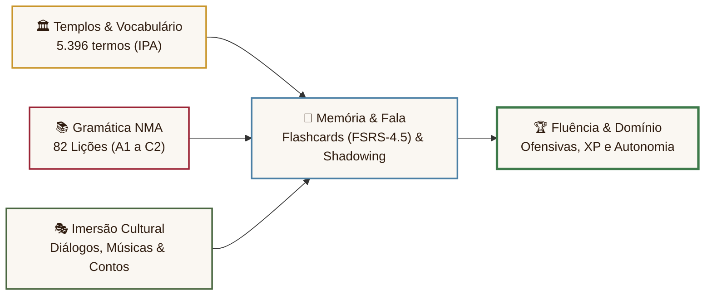
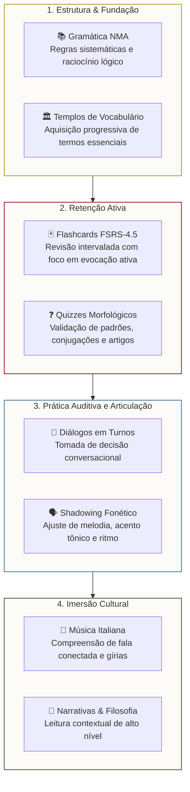
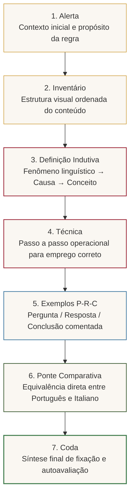

<div align="center">

  

  # Italiano Autentico
  ### PWA Progressivo para Estudo Imersivo da Língua Italiana

  [](https://bruno-felipe-conte.github.io/apprendimento-italiano/)
  [](https://developer.mozilla.org/pt-BR/docs/Web/Progressive_web_apps)
  [](https://bruno-felipe-conte.github.io/apprendimento-italiano/)
  [](https://bruno-felipe-conte.github.io/apprendimento-italiano/)

  <br>

  ```
  🏛️ 51 Templos de Vocabulário  •  📚 82 Lições NMA  •  💬 200 Diálogos  •  🗣️ 200 Treinos Fonéticos  •  🎵 100 Canções
  ```

</div>

---

## 🏛️ Visão Geral

O **Italiano Autentico** é uma aplicação web progressiva projetada para estudo sistemático do italiano, unindo a clássica pedagogia gramatical humanista ao ritmo de retenção da repetição espaçada moderna.

O sistema funciona inteiramente no navegador, armazena todo o progresso no aparelho do usuário e opera **100% offline** após o primeiro carregamento.



---

## 📊 Painel do Acervo

<div align="center">

| Recurso | Volume | Nível | Foco de Aprendizado |
| :--- | :---: | :---: | :--- |
| **🏛️ Vocabulário nos Templos** | **5.396** palavras | A1 – C2 | Transcrição IPA, gênero gramatical, plurais e exemplos práticos |
| **📚 Lições de Gramática** | **82** lições | A1 – C2 | Método analítico de Napoleão Mendes de Almeida em 7 camadas |
| **💬 Diálogos Situacionais** | **200** cenários | A1 – B2 | Prática interativa por turnos com situações de viagem e cotidiano |
| **🗣️ Treino de Imitação** | **200** exercícios | A1 – C1 | Técnica de *Shadowing* com foco em cadência e fonética real |
| **🎵 Canções Italianas** | **100** músicas | A1 – B2 | Treino de escuta com preenchimento contextual de lacunas (*Cloze*) |
| **📜 Histórias & Filosofia** | **38** textos | B1 – C2 | Tradução por parágrafo, vocabulário assistido e leitura reflexiva |
| **🃏 Sistema de Flashcards** | Algoritmo **FSRS-4.5** | Todos | Agendamento de repetição espaçada contínua para retenção de longo prazo |
| **❓ Quizzes Morfológicos** | Múltiplas etapas | A1 – B2 | Fixação de flexões verbais, artigos e regências |

</div>

---

## 🧭 Jornada de Estudo

A arquitetura do método conduz o estudante da base estrutural à fala autônoma:



---

## 🏛️ As 7 Camadas Gramaticais (Método NMA)

As lições de gramática seguem a arquitetura didática inspirada nas obras do gramático Napoleão Mendes de Almeida:



---

## 📱 Instalação como Aplicativo (PWA)

O aplicativo funciona diretamente no navegador e pode ser instalado sem loja de apps:

```
┌────────────────────────────────────────────────────────────────────────┐
│                        COMO INSTALAR EM 3 PASSOS                       │
├──────────────────────────┬──────────────────────────┬──────────────────┤
│        🤖 ANDROID        │         🍏 APPLE         │    💻 DESKTOP    │
│  Abra no Google Chrome   │      Abra no Safari      │  Chrome ou Edge  │
│            ↓             │            ↓             │        ↓         │
│     Toque em Menu ⋮      │  Toque em Compartilhar ⎋ │  Clique no ícone │
│            ↓             │            ↓             │  de instalação ⊕ │
│  "Instalar aplicativo"   │ "Adicionar à Tela Início"│ na barra URL     │
└──────────────────────────┴──────────────────────────┴──────────────────┘
```

> **Privacidade local garantida:** Todo o progresso (XP acumulado, ofensivas, cartões revisados e configurações) permanece salvo exclusivamente no `localStorage` do seu dispositivo.

---

## 🛠️ Desenvolvimento & Execução Local

O projeto utiliza Vite 8 e TypeScript estrito, com suíte automatizada de testes (Vitest + Playwright + axe-core):

```bash
# 1. Instalar dependências
npm install

# 2. Iniciar servidor de desenvolvimento (Vite)
npm run dev

# 3. Executar suíte de testes unitários (Vitest)
npm run test

# 4. Validar acervo de conteúdos mestres (Zod)
npm run content:validate

# 5. Validar integridade e mitigação de edge-cases FSRS-4.5
npm run fsrs:validate

# 6. Executar auditoria de acessibilidade WCAG 2.1 AA (@axe-core)
npm run test:a11y

# 7. Verificação de tipos estritos
npm run typecheck

# 8. Compilação de produção
npm run build
```

---

## 📂 Estrutura do Projeto

```text
apprendimento-italiano/
├── index.html              # Ponto de entrada (Single Page Application PWA)
├── vite.config.ts          # Configuração do Vite e Vitest
├── playwright.config.ts    # Configuração de testes de acessibilidade Playwright
├── tsconfig.json           # Configuração TypeScript (Strict mode)
├── css/
│   └── italia.css          # Design system clássico (Cinzel, Garamond, paleta renascentista)
├── types/
│   └── app.d.ts            # Contratos e tipos canônicos da aplicação
├── js/
│   ├── core/               # Módulos desacoplados de arquitetura, dados e sincronização
│   │   ├── state.js        # Estado reativo e persistência
│   │   ├── navigation.js   # Controle de navegação e sidebar
│   │   ├── xp.js           # Gamificação, cálculo de XP e ofensivas
│   │   ├── stats.js        # Estatísticas de estudo e Health Check
│   │   ├── plugins.ts      # Arquitetura de micro-plugins desacoplados (EV-01)
│   │   ├── sync.ts         # Fila offline-first e adaptadores Supabase/PocketBase (EV-02)
│   │   ├── analytics.ts    # Telemetria offline-first e testes A/B determinísticos (EV-04)
│   │   └── collaboration.ts# Reconciliação CRDT/LWW, shared decks e leaderboard (EV-05)
│   ├── plugins/            # Plugins modulares carregados sob demanda
│   ├── core.js             # Facade global retrocompatível (App.*)
│   ├── modal_manager.ts    # Gerenciador unificado de modais (focus trap, ARIA)
│   ├── progression.ts      # Motor de progressão e FSRS
│   ├── voice_engine.ts     # Síntese neural Piper TTS WASM + Web Speech API
│   ├── flashcards.js       # Agendador de repetição espaçada FSRS
│   ├── grammar.js          # Motor das lições de gramática
│   ├── vocab.js            # Explorador dos 51 Templos de Vocabulário
│   ├── dialoghi.js         # Simulação de diálogos interativos
│   ├── canzoni.js          # Exercícios com músicas e cloze test
│   ├── imitazione.js       # Treinos de shadowing fonético
│   └── storie.js           # Visualizador de histórias bilíngues
├── scripts/
│   ├── schemas.ts          # Schemas Zod canônicos para templos, gramática e histórias
│   ├── validate_content.ts # Pipeline de validação estrita de acervo de dados mestres
│   ├── validate-fsrs.js    # Verificador de integridade e edge cases de cartões FSRS
│   ├── ingest_content.ts   # Ingestão segura de novos módulos com deduplicação
│   └── stress-storage.js   # Benchmark e teste de estresse de localStorage
├── tests/
│   ├── a11y/               # Testes automatizados de acessibilidade (WCAG 2.1 AA)
│   ├── content_pipeline.test.ts # Testes do pipeline automatizado de conteúdo
│   ├── sync.test.ts        # Testes de sincronização offline-first e fila
│   ├── analytics.test.ts   # Testes de eventos e amostragem A/B
│   ├── collaboration.test.ts # Testes de reconciliação CRDT e decks compartilhados
│   ├── plugins.test.ts     # Testes do lifecycle de plugins
│   ├── progression.test.ts # Testes de progressão e FSRS
│   ├── voice_engine.test.ts# Testes do motor de áudio
│   ├── security.test.js    # Testes de sanitização XSS e segurança
│   └── navigation.test.js  # Testes de rotas e navegação
├── docs/
│   └── adr/                # Registros de Decisões Arquiteturais (ADRs 001 a 004)
├── data/                   # Acervo JSON (54 arquivos mestres validados com Zod)
├── sw.js                   # Service Worker (estratégia cache-first offline v140)
└── manifest.webmanifest    # Manifesto para instalação PWA
```

---

<div align="center">
  <br>
  <sub><i>Fatto per gli amanti della lingua e della cultura italiana.</i></sub>
</div>
